# HaloStory Go Backend — Architecture Blueprint

**Generated**: 2026-07-24  
**Project**: `halostory_go_backend`  
**Language**: Go 1.26.4  
**Framework**: Gin v1.12.0  
**ORM**: GORM v1.31.2  
**Database**: MySQL 8  
**Cache/Queue**: Redis 7  
**Object Storage**: MinIO/S3-compatible + Cloudinary  
**Architecture Pattern**: Layered Monolith with Async Job Queue Microservices

---

## 1. Architecture Detection and Analysis

### 1.1 Technology Stack

| Layer | Technology | Purpose |
|---|---|---|
| HTTP Framework | Gin v1.12.0 | REST API routing, middleware pipeline |
| ORM | GORM v1.31.2 + MySQL driver | Database access, query building |
| Database | MySQL 8 (utf8mb4, Asia/Jakarta TZ) | Persistent storage |
| Cache & Queue | Redis 7 (go-redis v9) | Rate limiting, job queue, chat result store, cooldowns |
| Object Storage | MinIO v7 (S3-compatible) | Bot avatar/image storage |
| Image CDN | Cloudinary v2 | Image URL transformation/caching |
| Auth | golang-jwt v5 (HS256) & Google Oauth2 | Stateless authentication |
| Encryption | AES-256-CBC + HMAC-SHA256 (custom crypto) | BYOK API key encryption (Laravel-compatible) |
| Email | gomail v2 (SMTP/Brevo) | OTP verification emails |
| Scheduler | robfig/cron v3 | Periodic jobs (unban, story gen, analytics) |
| Testing | testify v1.11.1 | Unit + integration tests |
| Validation | go-playground/validator v10 | Request binding validation |
| AI Providers | OpenAI, Anthropic Claude, Google Gemini, Mistral, DeepSeek, OpenRouter, Z.ai, NVIDIA, Huashang | AI chat processing |

### 1.2 Architectural Pattern

**Primary: Layered Monolith with Global Singletons**

The codebase follows a Laravel-inspired layered architecture:
- **Routes** → **Middlewares** → **Controllers** → **Models** + **Services** + **Utils**
- Global singletons mirror Laravel facades (`database.DB`, `services.RedisClient`, `services.MinioClient`, `services.CloudinaryClient`)
- No dependency injection container — direct package-level variable access

**Secondary: Async Job Queue Microservices**

Three separately deployable binaries sharing the same codebase:
1. **Server** (`cmd/server`) — REST API, port :3000
2. **Worker** (`cmd/worker`) — Background AI chat processor, port :3001 (health)
3. **Scheduler** (`cmd/scheduler`) — Cron job runner

Communication between server and worker is purely Redis-based (LPUSH/BLPOP).

---

## 2. Architectural Overview

### 2.1 Guiding Principles

- **Laravel migration compatibility**: Naming conventions (`TableName()` returning plural), bcrypt passwords, JWT structure, response format all mirror the original Laravel app
- **Response JSON MUST use structs** — never `gin.H` (to guarantee field ordering)
- **Nil slices → `make([]T, 0)`** — never return null arrays
- **No auto-migration** — DB schema already exists, GORM is read/write only
- **Bahasa Indonesia** for user-facing error messages
- **Global state** — services initialized at startup, accessed via package-level vars

### 2.2 Architectural Boundaries

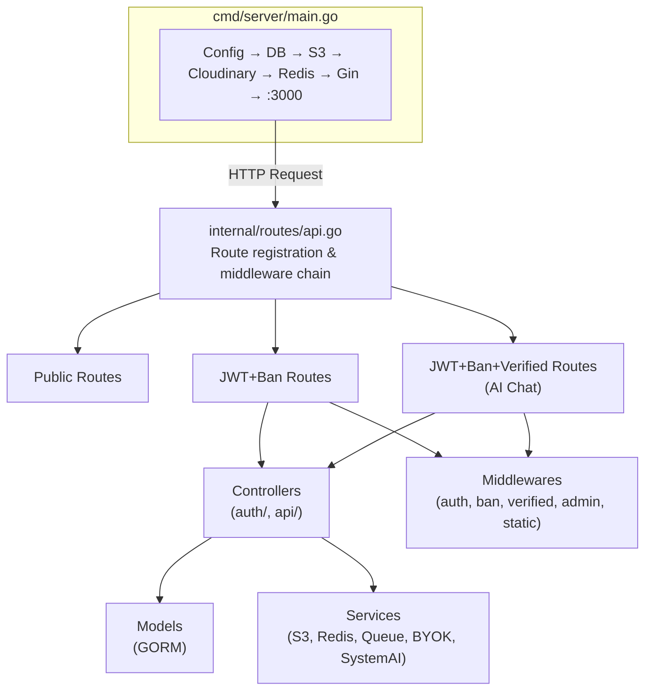

### 2.3 Hybrid Architecture

The system is **not** a pure layered monolith nor a pure microservices architecture — it is a hybrid:

- **Shared codebase**: All binaries compile from `internal/` — models, services, utils are shared
- **Separate deployment**: Each `cmd/` binary is a separate Docker container
- **Async decoupling**: Chat requests flow HTTP → Redis → Worker (no synchronous dependency)
- **Database coupling**: All three binaries connect to the same MySQL + Redis instances

---

## 3. Core Architectural Components

### 3.1 Entrypoints (`cmd/`)

**`cmd/server/main.go`** — REST API Server
- Loads `.env` → connects MySQL/Redis/S3/Cloudinary → creates Gin engine → registers routes → listens on `:3000`
- Health check at `/up` pings a Cloudflare Worker for maintenance mode
- Global middleware: Logger, Recovery, CORS

**`cmd/worker/main.go`** — AI Chat Worker (1492 lines)
- Polls `queue:ai-chat` via Redis BLPop
- Dual semaphore: 30 goroutines for BYOK, 6 for System AI
- Provider routing: OpenAI-compatible (shared), Claude, Gemini, System AI fallback chain
- Per-user overlapping lock via Redis `SetNX`
- Chat result stored in Redis with TTL (10 min), polled by client via `/chat/status/:uuid`
- Health server on `:3001`

**`cmd/scheduler/main.go`** — Cron Scheduler
- Starts robfig/cron with periodic jobs:
  - Every 1min: unban expired users, clean old stories (delete rated <7 after 24h)
  - Every 1hr: generate new AI stories from Safebooru images
  - Hourly/daily/weekly/monthly: analytics reports via Telegram bot

### 3.2 Configuration (`internal/config/`)

**Pattern**: Global accessor, no DI

```go
// config.go
func Env(key, fallback string) string  // os.Getenv with fallback
func LoadConfig()                        // godotenv.Load()
```

Env vars: APP_KEY, APP_ENV, APP_DEBUG, DB_*, REDIS_*, S3_*, MAIL_*, CLOUDINARY_*, AI provider keys, DISCORD_WEBHOOK, TELEGRAM_BOT_TOKEN, etc.

### 3.3 Database (`internal/database/`)

**Pattern**: Global singleton, direct package access

```go
var DB *gorm.DB
func Connect()  // opens MySQL with utf8mb4, plural table naming
```

- No migrations — schema managed externally (Laravel legacy)
- Timezone forced to `+07:00` (Asia/Jakarta)

### 3.4 Models (`internal/app/models/`)

11 GORM models + response structs + utility types.

**Key Models**:

| Model | Table | Role |
|---|---|---|
| `User` | `users` | Auth, roles (Sensei/admin), VIP, ban state |
| `Bot` | `bots` | AI character definitions, child flag |
| `UserBotBond` | `user_bot_bonds` | User-bot relationship state machine |
| `Category` | `categories` | Bot categorization, slug generation |
| `CharacterStory` | `character_stories` | AI-generated stories |
| `AppSetting` | `app_settings` | Key-value settings |
| `DeviceBan` | `device_bans` | Hardware-level ban |
| `StudentRequest` | `student_requests` | Character requests |
| `UserBackup` | `user_backups` | JSON data backup |
| `UserActivity` | `user_activities` | Analytics tracking |
| `EmailVerificationOtp` | — | Email OTP store |
| `PasswordResetToken` | `password_reset_tokens` | Password reset |
| `UserOauth` | `user_oauths` | Google Oauth |

**Domain Logic in Models**: `UserBotBond` contains significant domain logic:
- `GetLevel()` — cubic XP curve with O(1) initial guess + refinement
- `GetRelationshipLabel()` — state machine with context-aware labels
- `HasPendingChoice()` — decision points at level 50 and 100
- `ApplyChoice()` — bond state transitions
- `CanGainXp()` — blocked for enemy/rejected/stuck states

### 3.5 Services (`internal/services/`)

Infrastructure services initialized at startup as global variables:

| Service | Global Var | Role |
|---|---|---|
| `s3.go` | `MinioClient`, `S3Bucket` | MinIO/S3 object storage |
| `redis.go` | `RedisClient`, `RedisCtx` | Redis cache/queue |
| `cloudinary.go` | `CloudinaryClient` | Image CDN, `ImageURL()`, `UploadImage()` |
| `queue.go` | (uses RedisClient) | Job queue: Enqueue/Dequeue, chat result CRUD, Lua-based status update, cooldowns, pending list |
| `ratelimit.go` | (uses RedisClient) | Sliding window via INCR + EXPIRE |
| `discord.go` | — | Discord webhook notifications |
| `scheduler.go` | — | Cron job registration |

**BYOK Providers** (`internal/services/byok/`):
- `openai.go` — OpenAI-compatible HTTP client with retries (10x, 2s backoff), 429 handling
- `gemini.go` — Native Google Gemini API, `ConvertToOpenAIFormat()`
- `claude.go` — Anthropic Claude API with thinking config
- `models.go` — Multi-provider model listing (Gemini, Claude, OpenAI-compatible, Arli, Mancer, Horde, NovelAI)
- `prompt.go` — System prompt builder: bond context, child safety rules, group chat, language enforcement, XP rewards
- `bond.go` — `ParseBondTags()` regex-based AI response parsing, `AddBondXp()` XP calculation, `HandleChildSafety()` NSFW alerting
- `validate.go` — `SanitizeByokInput()` input validation, `IsTrustedBaseURL()` URL allowlisting

**System AI** (`internal/services/systemai/`):
- `systemai.go` — Provider config, RegularChain (NVIDIA → Huashang → Gemini → Mistral), PriorityModels for VIP
- `fallback.go` — `RunFallbackChain()` with circuit breaker, key rotation, VIP priority

### 3.6 Middlewares (`internal/app/http/middlewares/`)

| Middleware | Type | Function |
|---|---|---|
| `Protected()` | JWT auth | Validates HS256 JWT, loads user from DB, sets `c.Set("user", user)` |
| `CheckBanned()` | Authz | Checks `User.HasActiveBan()`, returns 403 |
| `CheckAdmin()` | Authz | Checks `User.Role == "admin"` |
| `EnsureEmailIsVerified()` | Authz | Checks `User.EmailVerifiedAt != nil` |
| `CheckStaticToken()` | Pre-auth | Validates static bearer token for pre-login endpoints |
| `SetupCORS()` | CORS | Allows all origins via gin-contrib/cors |

**Middleware Chain Order** (critical):

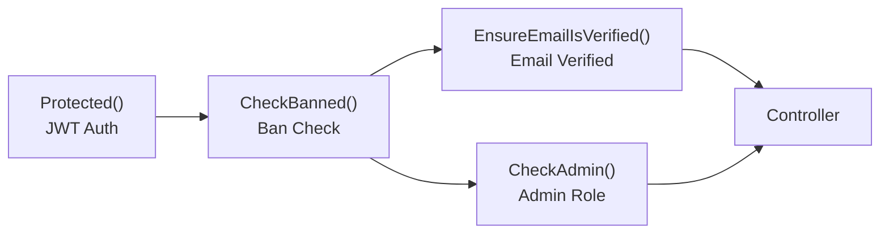

### 3.7 Controllers (`internal/app/http/controllers/`)

**`auth/`** — Authentication & profile:
- Login (bcrypt + JWT), Register (bcrypt + OTP auto-send)
- SendVerificationOtp, VerifyEmail (6-digit OTP, 15min expiry, bcrypt hashed)
- ForgotPassword, ResetPassword
- UpdateEmail, UpdateName, UpdatePassword, UpdatePersona
- ReportBannedDevice

**`api/`** — Business features:
- BotIndex, ShowBio — Bot browsing with bond data, birthday detection
- CategoryIndex, CategoryBots — Category browsing
- BotTabIndex, RecruitedBotsIndex — User's bonded bot lists
- BondRecruit, BondShow, BondHandleChoice, BondDebugUpdate — Bond CRUD + state machine
- GetByBondedBots — Stories for user's bots
- CalendarIndex — Birthday calendar
- BackupStore, BackupRestore — User JSON data backup
- ImageProxy — S3 image proxy via MinIO
- AppStatus — Version + maintenance mode
- GetCall — Random call video URL
- StudentRequestIndex, StudentRequestStore
- SystemChat, Summarize, GetSystemPrompt — System AI
- Admin* — Full admin CRUD (users, bots, categories, settings, stats, charts, student requests, bulk operations)

**`api/byok/`** — BYOK AI endpoints:
- GeminiChat, ClaudeChat, MistralChat, DeepSeekChat, OpenRouterChat, ZAIChat, OpenAICompatibleChat
- FetchModels — Provider model listing
- ChatStatus — Polling endpoint for completed chat results

---

## 4. Architectural Layers and Dependencies

### 4.1 Layer Map

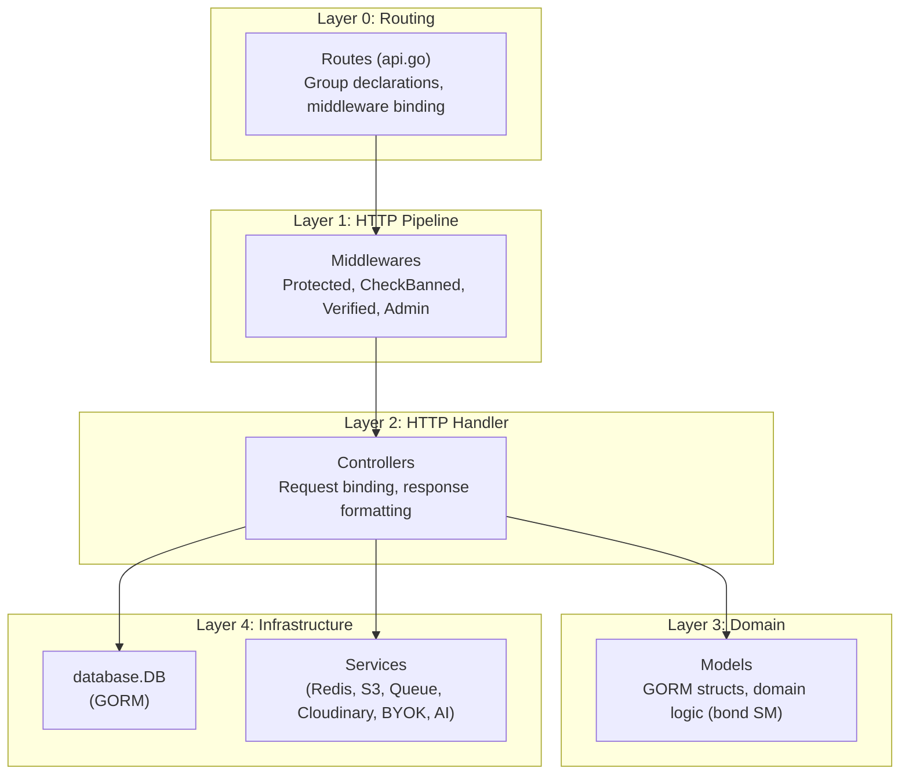

### 4.2 Dependency Rules

- **Routes** depends on: Controllers, Middlewares, Models (user type assertion)
- **Middlewares** depends on: Models, Config, Database
- **Controllers** depends on: Models, Database, Services, Utils, Config
- **Services** depends on: Config, external SDKs
- **Models** depends on: GORM, standard library only
- **Utils** depends on: Config, external SDKs

### 4.3 Circular Dependencies

No circular dependencies found. The dependency graph is acyclic:

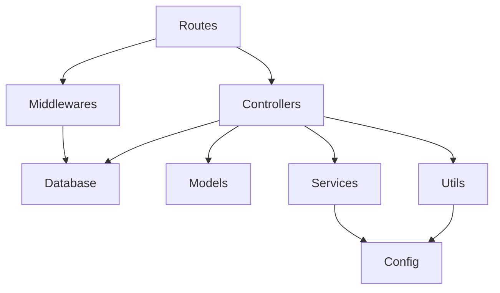

### 4.4 Dependency Injection Pattern

**No DI container**. The codebase uses **global package-level singletons**:

```go
// database/database.go
var DB *gorm.DB

// services/s3.go
var MinioClient *minio.Client

// services/redis.go
var RedisClient *redis.Client
```

All consumers import and use these globals directly:
```go
import "halostory_go_backend/internal/database"
database.DB.Where("email = ?", email).First(&user)
```

This is a known architectural debt — it prevents mock-based unit testing of controllers and services that depend on database or Redis.

---

## 5. Data Architecture

### 5.1 Domain Model Structure

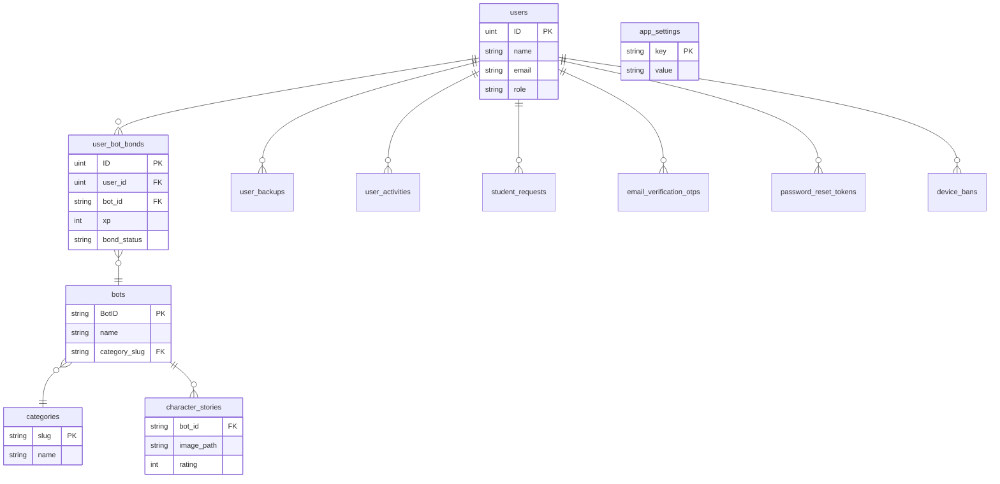

### 5.2 Entity Relationships (GORM)

| Source | Relation | Target | Foreign Key |
|---|---|---|---|
| `UserBotBond` | BelongsTo | `User` | UserID |
| `UserBotBond` | BelongsTo | `Bot` | BotID → Bot.BotID |
| `Bot` | HasMany | `CharacterStory` | BotID |
| `Category` | HasMany | `Bot` | CategorySlug → Bot.CategorySlug |

### 5.3 Data Access Patterns

**GORM Queries** — direct `database.DB` calls in controllers:
```go
// Direct queries (no repository layer)
database.DB.Select("bot_id, name, ...").Find(&bots)
database.DB.Where("user_id = ?", user.ID).Find(&bonds)
database.DB.Model(&models.User{}).Where("email = ?", req.Email).Count(&count)
database.DB.Where("email = ?", req.Email).First(&user)
database.DB.Create(&user)
database.DB.Save(&bot)
database.DB.Delete(&category)
```

**Pattern**: No repository/DAO abstraction — controllers talk directly to GORM.

### 5.4 Data Transformation

- **Personality parsing**: Regex-based extraction of structured fields from raw personality text (`ShowBio`)
- **Birthday detection**: Date comparison logic duplicated in `bot_controller.go` and `category_controller.go`
- **Bond level**: Cubic XP curve formula, `GetLevel()` with O(1) inverse-cubic guess + refinement
- **Image URLs**: `services.ImageURL(avatar)` wraps Cloudinary URL transformation
- **JSON fields**: Custom `JSON` type (scanner/valuer) in `UserBackup.Data`

### 5.5 Caching Strategy

- **Redis-based rate limiting**: INCR + EXPIRE per IP per action
- **Chat results**: Stored in Redis with 10-minute TTL, polled by client
- **Cooldowns**: Per-user AI chat cooldown in Redis
- **No query result caching**: All database queries hit MySQL directly

### 5.6 Data Validation Patterns

- **Request binding**: `c.ShouldBind(&req)` with `binding:"required,email,min,max"` tags
- **Custom validation errors**: `formatValidationErrors()` — Laravel-compatible error format with field mapping
- **BYOK input sanitization**: `SanitizeByokInput()` — message length, API key format, model name, base URL allowlisting
- **Fake email detection**: External API call to fakefilter.net on registration

---

## 6. Cross-Cutting Concerns

### 6.1 Authentication & Authorization

**Authentication Model**: JWT (HS256, 7-day expiry)
- Token contains: `sub` (user ID), `exp`, `iat`
- `APP_KEY` from `.env` as signing secret
- Laravel-compatible bcrypt password hashing

**Authorization Layers** (enforced as Gin middleware chain):
1. `Protected()` — Validates JWT, loads user
2. `CheckBanned()` — Blocks banned users (403 with reason + expiry)
3. `EnsureEmailIsVerified()` — Blocks unverified emails
4. `CheckAdmin()` — Admin-only endpoints
5. `CheckStaticToken()` — Pre-login static bearer token

**Security Boundaries**:
- `/user/report-banned-device` — only JWT, no banned check (banned users can report)
- `/admin/*` — JWT + ban check + admin role check
- `/byok/*` — JWT + ban check + email verification
- `/login`, `/register` — static token for pre-auth endpoints

### 6.2 Error Handling & Resilience

**Pattern**: Direct error return in controllers (no global handler)
```go
if err != nil {
    c.JSON(http.StatusInternalServerError, gin.H{
        "message": "Gagal mendaftarkan user",
    })
    return
}
```

**Retry Patterns**:
- BYOK OpenAI client: 10 retries with 2-second exponential backoff, 429 handling
- System AI fallback: `RunFallbackChain()` iterates through providers with circuit breaker

**Graceful Degradation**:
- `/up` health check: Falls back to "OK" if Cloudflare Worker is unreachable
- Image proxy: Depends on S3 availability
- Redis warnings: Non-fatal on connection failure (logs warning, continues)

### 6.3 Logging & Monitoring

- **Gin Logger**: HTTP request logging (standard)
- **Gin Recovery**: Panic recovery middleware
- **Console logging**: `log.Println`, `log.Fatal` throughout
- **Telegram analytics**: Hourly/daily/weekly/monthly user activity reports
- **Discord webhooks**: Student request notifications, child safety alerts
- **Health checks**: Docker HEALTHCHECK on `/api/ping` (server) and `/health` (worker)

### 6.4 Configuration Management

- **Source**: `.env` file loaded via godotenv
- **Pattern**: `config.Env("KEY", "default")` — wraps `os.Getenv()` with fallback
- **Secret management**: API keys (BYOK, AI providers) in `.env`, not committed
- **BYOK encryption**: User-provided API keys encrypted with AES-256-CBC + HMAC-SHA256 (Laravel-compatible)

### 6.5 Validation

- **Input validation**: `go-playground/validator/v10` via Gin binding tags
- **Business validation**: Inline in controllers (e.g., email uniqueness check)
- **BYOK sanitization**: Dedicated `SanitizeByokInput()` function
- **Error format**: Laravel-compatible JSON with field-level error arrays

---

## 7. AI Chat Architecture (Core Business Domain)

### 7.1 Dual AI System Design

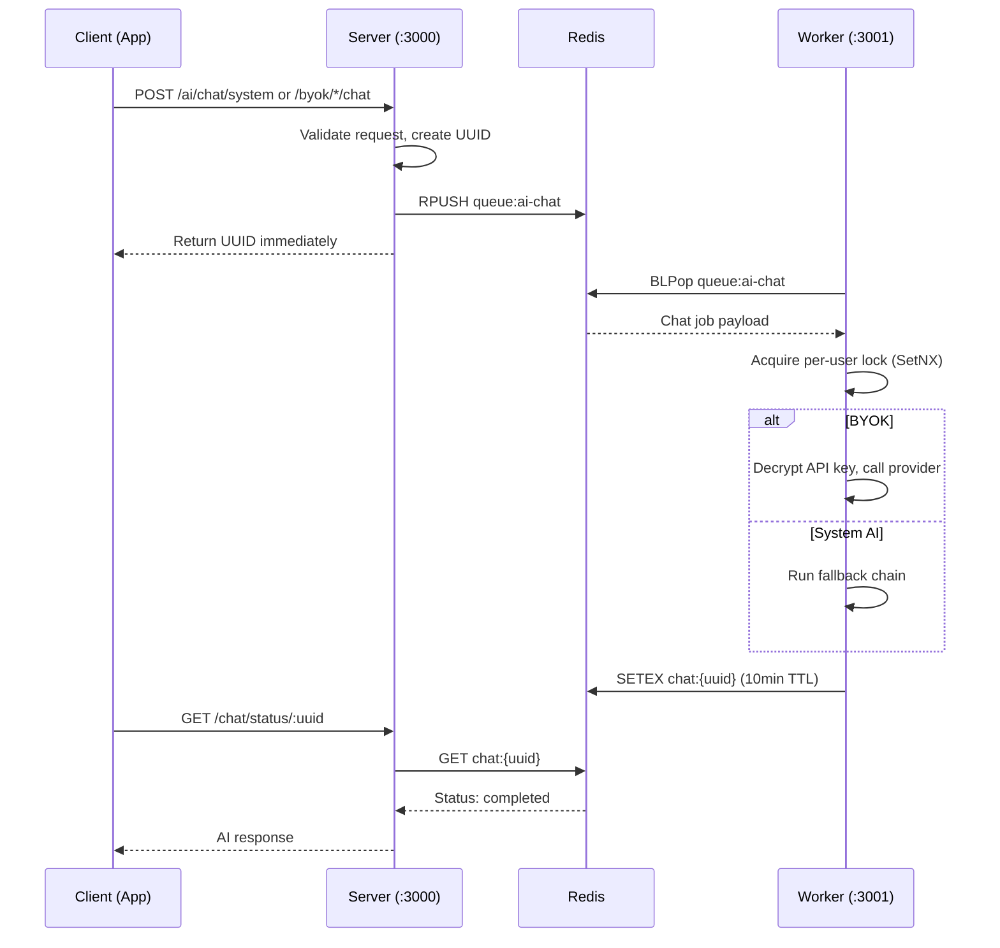

### 7.2 Chat Flow

1. **Client** sends chat request to server endpoint
2. **Server** validates request, creates UUID, enqueues to `queue:ai-chat` (Redis RPUSH)
3. **Server** returns UUID to client immediately
4. **Worker** pops from queue (BLPop), acquires per-user lock (SetNX), processes:
   - BYOK: decrypts API key, calls provider directly
   - System AI: runs fallback chain through multiple providers
5. **Worker** parses AI response for bond tags, updates XP/bond state
6. **Worker** stores result in `chat:{uuid}` (Redis SETEX, 10min TTL)
7. **Client** polls `GET /chat/status/:uuid` until status = "completed"
8. **Client** receives AI response

### 7.3 System AI Fallback Chain

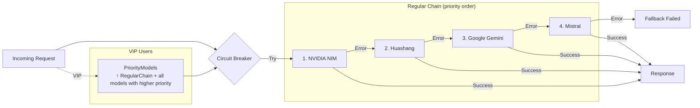

### 7.4 BYOK Provider Abstraction

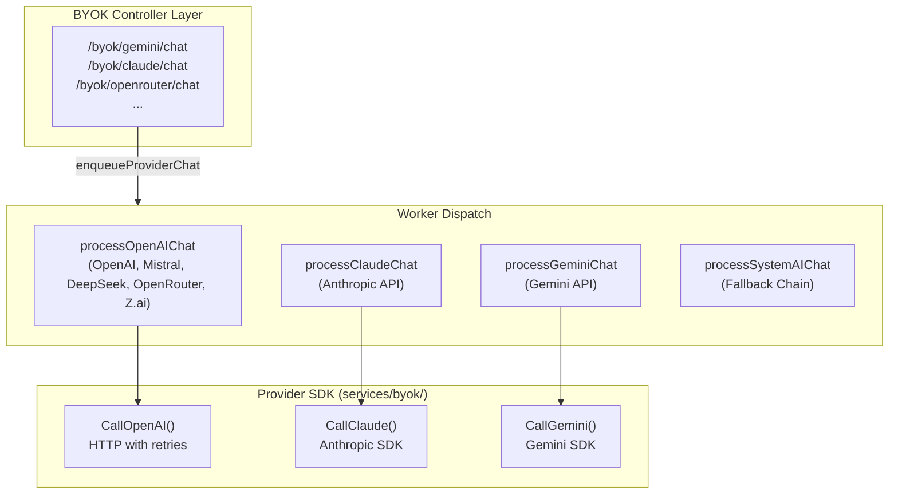

### 7.5 Bond System State Machine

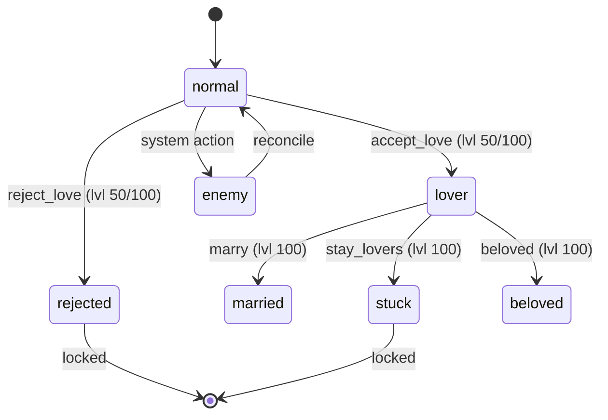

---

## 8. Admin Architecture

### 8.1 Embedded SPA Admin Panel

**No build step**: HTML/JS SPA served directly by Gin via `//go:embed`

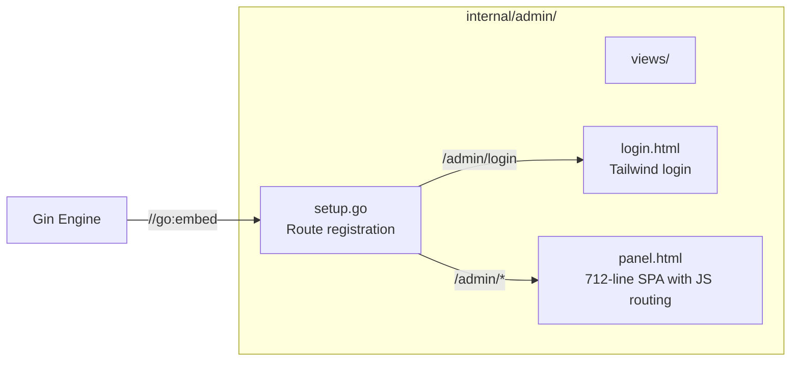

**Features**:
- CRUD for users, bots, categories, settings, student requests
- Bulk import bots (JSON upload)
- Bulk assign categories
- Analytics charts (Chart.js)
- BYOK tester (test AI providers from admin panel)
- Statistics dashboard

**Auth**: Separate admin session token (fetched from `/api/admin/login`)

---

## 9. Service Communication Patterns

### 9.1 Synchronous (HTTP/JSON)

All API communication is synchronous HTTP/JSON via Gin:
- Request → Middleware chain → Controller → Response
- Format: JSON with `gin.H` or typed structs
- Status codes: 200, 201, 403, 422, 500

### 9.2 Asynchronous (Redis Queue)

AI chat processing uses async job queue:
- **Producer**: Server controller → `Enqueue("ai-chat", payload)`
- **Consumer**: Worker → `Dequeue("ai-chat", timeout)` (BLPop)
- **Result store**: `StoreChatResult(uuid, result, ttl)` → `GetChatResult(uuid)`
- **Status tracking**: Lua script for atomic `UpdateChatStatus`
- **Locking**: Redis `SetNX` per `user:bot` to prevent duplicate processing
- **Cooldown**: Redis `SETEX` per user

### 9.3 API Versioning Strategy

- Mix of versioned (`/api/v1/*`) and unversioned (`/api/bots/*`) endpoints
- Versioned: categories, bot-tab, recruited-bots, stories, calendar
- Unversioned: auth, bots, bonds, image, user, backup, student-requests
- BYOK: `/api/byok/*`
- Admin: `/api/admin/*`

---

## 10. Testing Architecture

### 10.1 Test Structure

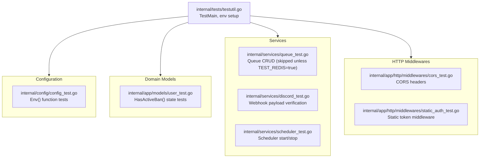

### 10.2 Patterns

- **testify/assert** for assertions
- `TestMain` in `internal/tests/testutil.go` sets env vars globally
- Redis-dependent tests guarded by `os.Getenv("TEST_REDIS") == "true"`
- No mock framework — integration tests use real dependencies

### 10.3 Coverage Gaps

- No controller tests (no mockable database layer)
- No BYOK service tests
- No end-to-end tests
- No HTTP handler integration tests

---

## 11. Deployment Architecture

### 11.1 Docker Multi-Stage Build

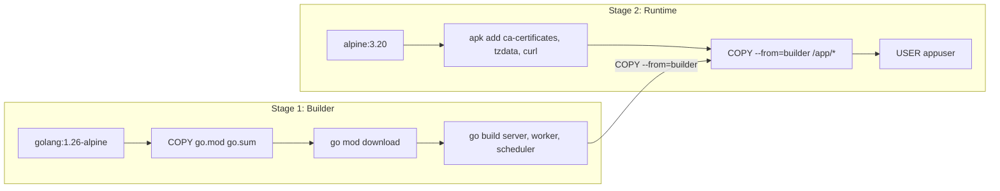

Three binaries produced: `server`, `worker`, `scheduler`

### 11.2 Docker Compose Topology

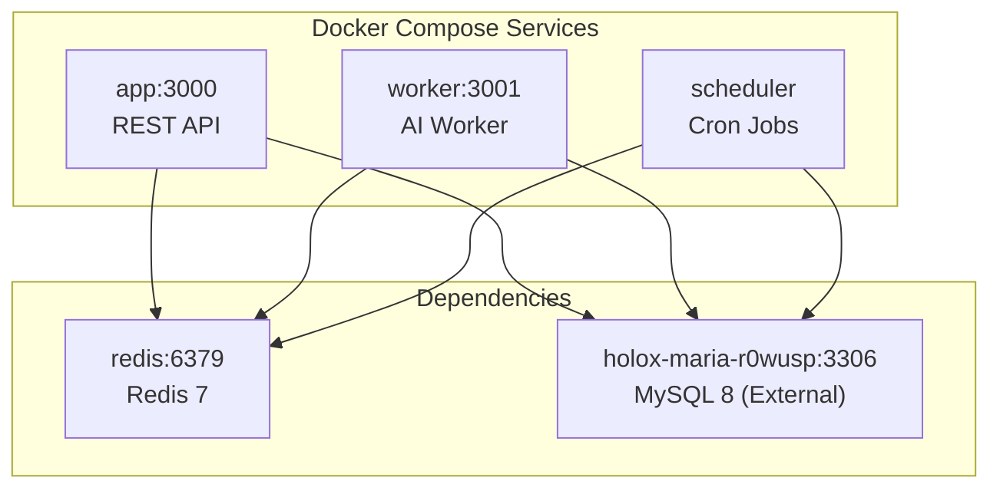

### 11.3 Environment-Specific Config

- `.env` file loaded at runtime
- Docker compose overrides: `DB_HOST`, `REDIS_HOST` differ between local and Docker
- `dokploy-network` for cross-container communication with external DB
- `APP_ENV` and `APP_DEBUG` control Gin mode and debug endpoints

---

## 12. Extension and Evolution Patterns

### 12.1 Adding a New Feature

**Step-by-step**:

1. **Model** (if needed): Add struct in `internal/app/models/` with `TableName()`
2. **Controller**: Add handler in `internal/app/http/controllers/api/` or `auth/`
3. **Route**: Register in `internal/routes/api.go` with appropriate middleware chain
4. **Response struct**: Define typed struct (never `gin.H`)
5. **Service** (if needed): Add to `internal/services/`

### 12.2 Adding an AI Provider

1. Add controller in `internal/app/http/controllers/api/byok/`
2. Add SDK client in `internal/services/byok/`
3. Register route in `api.go` under `verified` group
4. Add to worker dispatch in `cmd/worker/main.go`

### 12.3 Key Extension Points

| Extension Point | Location | Mechanism |
|---|---|---|
| New route | `routes/api.go` | `api.POST("/new-endpoint", handler)` |
| New middleware | `middlewares/` | Gin `HandlerFunc` returning func |
| New AI provider | `services/byok/` | Implement `CallProvider()` pattern |
| New cron job | `services/scheduler.go` | `cronScheduler.AddFunc("@every 1m", fn)` |
| New model | `models/` | GORM struct + `TableName()` |
| New env config | `config.go` | `config.Env("NEW_KEY", "default")` |

### 12.4 Modification Safety

- **Backward compatibility**: Response struct fields can be added; never remove or rename
- **Deprecation**: Keep old endpoints alongside new versioned ones
- **Migration**: Route versioning (`/api/v1/*`) allows gradual endpoint migration

---

## 13. Architecture Governance

### 13.1 Enforced Conventions

| Rule | Enforcement |
|---|---|
| Response JSON MUST use structs | Manual code review |
| Nil slices → `make([]T, 0)` | Manual code review |
| No auto-migration | Hard rule — never add to `main.go` |
| Table names plural via `TableName()` | GORM convention |
| Nullable fields as pointers | Go convention |
| Passwords/OTPs with `json:"-"` | Security requirement |
| Error messages in Bahasa Indonesia | Manual code review |

### 13.2 Known Architectural Debt

1. **No dependency injection** — global singletons prevent effective unit testing
2. **No repository layer** — controllers couple directly to GORM
3. **Duplicate birthday logic** — in `bot_controller.go` and `category_controller.go`
4. **`math/rand` for OTP** — should use `crypto/rand`
5. **Hardcoded template path** — `internal/templates/otp.html` relative to CWD
6. **JWT fallback secret** — default `"halo_story_default_secret_key"` in code
7. **No request validation middleware** — validation scattered in controllers
8. **No structured error types** — ad-hoc `gin.H` error responses
9. **No API documentation** — no OpenAPI/Swagger specs

---

## 14. Blueprint for New Development

### 14.1 New Controller Template

```go
package api

import (
    "halostory_go_backend/internal/app/models"
    "halostory_go_backend/internal/database"
    "net/http"

    "github.com/gin-gonic/gin"
)

type MyFeatureResponse struct {
    ID   uint   `json:"id"`
    Name string `json:"name"`
}

func MyFeatureHandler(c *gin.Context) {
    userVal, _ := c.Get("user")
    user := userVal.(models.User)

    var results []models.SomeModel
    database.DB.Where("user_id = ?", user.ID).Find(&results)

    resp := make([]MyFeatureResponse, 0)
    for _, r := range results {
        resp = append(resp, MyFeatureResponse{ID: r.ID, Name: r.Name})
    }

    c.JSON(http.StatusOK, resp)
}
```

### 14.2 Route Registration Template

```go
// In routes/api.go

// 1. Public (no auth)
api.GET("/v1/my-feature", apiControllers.MyFeatureHandler)

// 2. Protected + banned check
protected.GET("/v1/my-feature", apiControllers.MyFeatureHandler)

// 3. Verified only (inside verified group)
verified.POST("/my-feature", apiControllers.MyFeatureHandler)

// 4. Admin only (inside admin group)
admin.POST("/my-feature", apiControllers.AdminMyFeatureHandler)
```

### 14.3 Common Pitfalls to Avoid

- ❌ Using `gin.H` for response — use typed structs
- ❌ Returning nil slices — use `make([]T, 0)`
- ❌ Adding `AutoMigrate` calls
- ❌ Hardcoding secrets or paths
- ❌ Skipping middleware chain order (Protected → Banned → Verified → Admin)
- ❌ Forgetting `json:"-"` on password/OTP fields
- ❌ Using non-pointer types for nullable DB columns

---

## 15. File Index

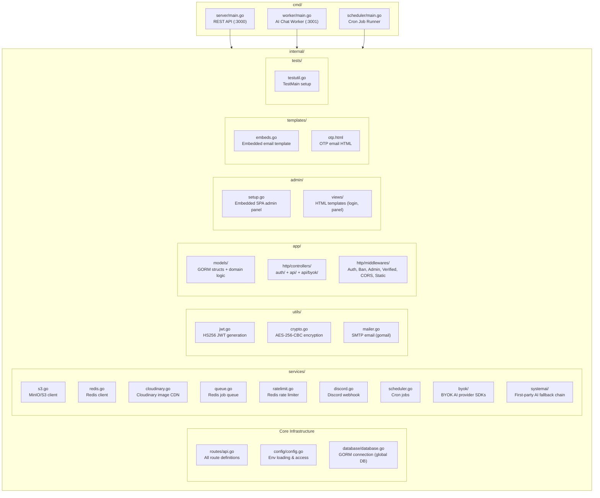

---

*This blueprint was generated from codebase analysis. It should be reviewed and updated as the architecture evolves, particularly when new services, providers, or architectural patterns are introduced.*
