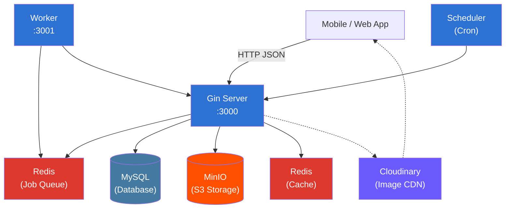

# HaloStory Backend

[](https://go.dev/)
[](https://gin-gonic.com/)
[](https://gorm.io/)
[](https://www.mysql.com/)
[](https://redis.io/)
[](https://min.io/)
[](LICENSE)

Anime AI character interaction platform backend — chat with AI characters, build relationships, and explore stories. Built with Go, ported from a Laravel codebase.

---

## Table of Contents

- [Architecture](#architecture)
- [Features](#features)
- [Getting Started](#getting-started)
- [Configuration](#configuration)
- [Project Structure](#project-structure)
- [API Overview](#api-overview)
- [Development](#development)

---

## Architecture



The backend is composed of three binaries:

- **`server`** (:3000) — Gin HTTP API server handling all client requests.
- **`worker`** (:3001) — Background job processor for AI chat requests, consuming a Redis list-based queue.
- **`scheduler`** — Cron-based task scheduler for periodic jobs (hourly story images, analytics reports).

## Features

- **AI Character Chat** — Multi-provider chat with system AI (fallback chain across Gemini, Groq, OpenRouter, Mistral, and more) and Bring-Your-Own-Key (BYOK) mode supporting Gemini, Claude, Mistral, DeepSeek, OpenRouter, ZAI, and OpenAI-compatible endpoints.
- **Relationship/Bond System** — XP-based leveling with cubic curve formula, relationship stages (normal → lover → married → rejected), and choice mechanics at milestone levels.
- **Bot Catalog** — Browse AI characters organized by categories, with detailed profiles, birthdays, personalities, and avatar images.
- **Character Stories** — Hourly auto-generated images from Safebooru using character tags, served with 24-hour auto-expiry.
- **User Management** — Registration, email verification via OTP, password reset, profile updates, and role-based access (Sensei / VIP / admin).
- **Admin Panel** — Full CRUD for users, bots, categories, settings, and student requests, with activity charts and statistics.
- **Student Requests** — Users can request new characters; admin approves/rejects with Discord notifications.
- **Analytics & Notifications** — Hourly/daily/weekly/monthly activity reports to Telegram, Discord webhooks for moderation events.
- **Backup/Restore** — JSON-based user data backup and restore.

## Getting Started

### Prerequisites

- Go 1.26+
- MySQL or MariaDB
- Redis
- [Air](https://github.com/air-verse/air) (for hot reload)

### Quick Start

```bash
# Clone the repository
git clone <repo-url> && cd hsai_go_backend

# Copy environment configuration
cp .env.example .env
# Edit .env with your database credentials and API keys

# Run the server with live reload
air
```

> [!IMPORTANT]
> The database is managed externally (migrated from Laravel). The backend does **not** use auto-migration — the schema must exist before starting the server.

### Docker

```bash
make docker-up
```

This starts the server, worker, scheduler, and Redis using Docker Compose. See `docker-compose.yml` for service configuration.

## Configuration

Configuration is managed through environment variables in `.env`. Key settings:

| Variable | Description |
|---|---|
| `APP_KEY` | JWT signing key (HS256) |
| `DB_HOST`, `DB_PORT`, `DB_DATABASE`, `DB_USERNAME`, `DB_PASSWORD` | MySQL connection |
| `REDIS_HOST`, `REDIS_PORT` | Redis connection |
| `S3_KEY`, `S3_SECRET`, `S3_BUCKET`, `S3_ENDPOINT` | MinIO / S3-compatible storage |
| `MAIL_HOST`, `MAIL_USERNAME`, `MAIL_PASSWORD` | SMTP (Brevo recommended) |
| `GEMINI_SYSTEM_KEY`, `GROQ_SYSTEM_KEY`, `MISTRAL_SYSTEM_KEY` | AI provider keys for system chat |
| `API_STATIC_TOKEN` | Bearer token required for pre-login endpoints |
| `DISCORD_WEBHOOK_URL` | Discord notifications |
| `TELEGRAM_BOT_TOKEN`, `TELEGRAM_USER_ID` | Telegram analytics reports |

See `.env.example` for all available options.

## Project Structure

```
cmd/
  server/           -- HTTP server entrypoint (:3000)
  worker/           -- Background job processor (:3001)
  scheduler/        -- Cron task scheduler
internal/
  config/           -- env loader
  database/         -- GORM connection
  routes/           -- Route definitions
  services/
    s3.go           -- MinIO client
    redis.go        -- Redis client
    queue.go        -- AI chat job queue
    scheduler.go    -- Cron job registry
    discord.go      -- Discord webhook
    telegram.go     -- Telegram notifications
    cloudinary.go   -- Cloudinary CDN
  utils/
    jwt.go          -- HS256 JWT (7-day expiry)
    mailer.go       -- Brevo SMTP
  app/
    models/         -- GORM structs + TableName()
    http/
      controllers/
        auth/       -- Login, Register, OTP, Password reset
        api/        -- Bot, Bond, Category, Story, AI Chat, Admin
      middlewares/   -- JWT auth, ban check, admin check, CORS, static token
  templates/        -- Email HTML template (embedded via //go:embed)
  tests/            -- Test helpers
```

## API Overview

| Method | Path | Auth | Description |
|--------|------|------|-------------|
| GET | `/api/ping` | Public | Health check |
| GET | `/api/image?path=` | Public | S3 image proxy |
| POST | `/api/login` | Static token | Login |
| POST | `/api/register` | Static token | Register |
| GET | `/api/user` | JWT | Current user profile |
| GET | `/api/v1/categories` | JWT | List categories |
| GET | `/api/v1/category/:slug` | JWT | Bots in a category |
| GET | `/api/bots` | JWT + verified | List all bots |
| POST | `/api/bots/recruit` | JWT | Recruit a bot |
| GET | `/api/bots/bond/:bot_id` | JWT | Bond details |
| POST | `/api/bots/bond/:bot_id/choice` | JWT | Relationship choice |
| POST | `/api/ai/chat/system` | JWT + verified | System AI chat |
| POST | `/api/byok/:provider/chat` | JWT + verified | BYOK AI chat |
| GET | `/api/v1/stories` | JWT | Character stories |
| POST | `/api/email/send-verification-otp` | JWT | Send OTP |
| POST | `/api/email/verify` | JWT | Verify email |
| GET | `/api/admin/users` | JWT + admin | List users |
| POST | `/api/admin/bots` | JWT + admin | Create bot |

See [admin_api.md](admin_api.md) for detailed admin endpoint documentation.

### Auth Flow

1. **Static token** — required for pre-login endpoints (login, register, forgot password).
2. **JWT** — obtained after login, valid for 7 days.
3. **Ban check** — runs after JWT auth; banned users are rejected.
4. **Email verification** — required for chat and bot listing endpoints.
5. **Admin role** — required for admin panel endpoints.

## Development

### Commands

```bash
air                      # Start dev server with hot reload
make test                # Run all tests
make test-coverage       # Run tests with coverage report
make build               # Build all binaries (server + worker + scheduler)
make docker-up           # Start all services with Docker Compose
make docker-down         # Stop all services
```

> [!TIP]
> Use `air` instead of `go run` for development — it automatically rebuilds and restarts on file changes.

### Testing

Tests use the standard `testing` package with `testify` for assertions. Redis-dependent tests require `TEST_REDIS=true` environment variable.

```bash
make test
```

### Testing Stack

- Standard `testing` package
- `stretchr/testify` for assertions
- `httptest` for HTTP middleware tests
- Tests gated with `TEST_REDIS=true` for Redis-dependent suites
