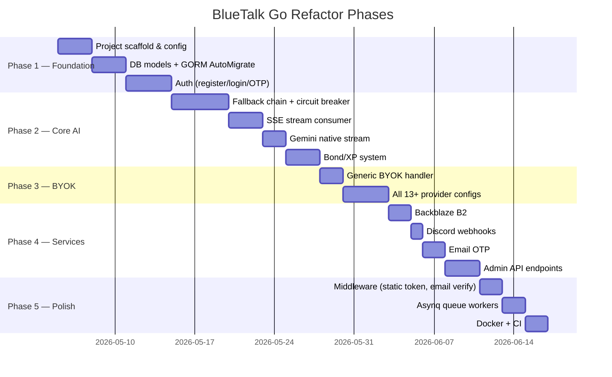

# BlueTalk Backend — Go Refactor Plan

## Locked Decisions

| Decision | Choice | Rationale |
|---|---|---|
| **Auth** | JWT (HS256) | Stateless — no DB hit per request; `user_id`, `role`, `is_vip` embedded in claims |
| **Admin Panel** | Separate React frontend (e.g., Refine.dev) | Admin API exposed as pure JSON endpoints from Go; Filament fully dropped |
| **Cache Backend** | Redis only | Required for Asynq queue + circuit breaker + VIP key rotation + B2 auth token |

---

## 1. What Does This Codebase Actually Do?

| Concern | PHP / Laravel Implementation |
|---|---|
| **Auth** | Laravel Sanctum (Bearer tokens), OTP via email (bcrypt-hashed in DB), password reset |
| **AI Proxy (System)** | Multi-provider fallback chain (Gemini, Groq, OpenRouter, MistralAI, Nvidia, Cohere, Cerebras) with circuit-breaker & per-user rate limiting |
| **BYOK (Bring Your Own Key)** | 13+ provider-specific controllers (Gemini, Claude, DeepSeek, Groq, Mistral, OpenRouter, Arli, Mancer, Featherless, Chutes, NanoGPT, Venus, ZAI, NovelAI, Horde, OpenAI-compatible) |
| **SSE Streaming** | `consumeStreamAsJson` — reads SSE from provider, assembles full text, returns as JSON |
| **Bond/XP System** | `UserBotBond` model with cubic-curve XP formula, relationship milestones, choice gating |
| **Bot & Story** | CRUD bots, character stories, story proxy |
| **Admin Panel** | Filament v3 (web) + JSON Admin API (user CRUD, bot CRUD/import, student requests) |
| **Backup** | User data backup/restore via Backblaze B2 (`BackblazeService`) |
| **Storage** | Backblaze B2 (upload, signed URL, download auth) |
| **Notifications** | Discord webhooks (`DiscordService`) |
| **Cache** | Laravel Cache (circuit-breaker counters, B2 auth token, VIP key rotation index) |
| **Queue** | Laravel Queue (background jobs) |
| **Static Auth** | `CheckStaticToken` middleware (pre-login header check) |
| **Email** | SMTP via Laravel Mail (OTP templates) |
| **DB** | MySQL / MariaDB with 23 migrations |

---

## 2. Recommended Go Framework: **Fiber v2**

### Why Fiber?

| Criterion | Fiber v2 | Gin | Echo | Chi |
|---|---|---|---|---|
| Performance | ⭐⭐⭐⭐⭐ (fastest, built on fasthttp) | ⭐⭐⭐⭐ | ⭐⭐⭐⭐ | ⭐⭐⭐ |
| Middleware ecosystem | ⭐⭐⭐⭐⭐ (limiter, cache, cors, logger built-in) | ⭐⭐⭐⭐ | ⭐⭐⭐⭐ | ⭐⭐⭐ |
| Laravel-feel routing | ✅ Groups, prefix, middleware chaining | ✅ | ✅ | ✅ |
| Built-in rate limiter | ✅ `fiber/middleware/limiter` | ❌ external | ❌ external | ❌ external |
| Built-in cache middleware | ✅ | ❌ | ❌ | ❌ |
| SSE support | ✅ native `c.SendStreamWriter` | ⚠️ manual | ⚠️ manual | ⚠️ manual |
| HTTP client (for AI proxying) | Resty v2 or `net/http` | same | same | same |

**Verdict:** Fiber v2 is the closest Laravel-like experience in Go — route groups, middleware stacking, built-in rate limiting, and SSE streaming all map naturally to your current PHP code.

---

## 3. Full Go Package Stack

| Laravel Concern | Go Replacement |
|---|---|
| Framework | `github.com/gofiber/fiber/v2` |
| Auth / JWT tokens | `github.com/golang-jwt/jwt/v5` (stateless) or keep opaque tokens with Redis |
| ORM | `gorm.io/gorm` + `gorm.io/driver/mysql` |
| Auto-migrations | GORM `AutoMigrate` |
| Validation | `github.com/go-playground/validator/v10` |
| Password hashing | `golang.org/x/crypto/bcrypt` |
| Cache / Circuit breaker | `github.com/go-redis/redis/v9` (Redis) or `github.com/patrickmn/go-cache` (in-memory) |
| Rate limiting | `github.com/gofiber/fiber/v2/middleware/limiter` |
| HTTP client (AI calls) | `github.com/go-resty/resty/v2` |
| Email (OTP) | `github.com/wneessen/go-mail` or `gopkg.in/gomail.v2` |
| Config (.env) | `github.com/joho/godotenv` + `github.com/spf13/viper` |
| Logging | `go.uber.org/zap` (structured, same as Laravel Log) |
| Background jobs / queue | `github.com/hibiken/asynq` (Redis-backed, Laravel Queue equivalent) |
| Discord webhooks | Plain `net/http` POST (2 functions, trivial) |
| Backblaze B2 | Plain `net/http` (B2 v2 API calls, matches `BackblazeService` exactly) |
| Admin UI (replace Filament) | `github.com/go-gorm/datatypes` + separate frontend, OR keep a thin Go-based admin API and wire to any React/Vue admin template |
| CORS | `github.com/gofiber/fiber/v2/middleware/cors` |
| Logger middleware | `github.com/gofiber/fiber/v2/middleware/logger` |
| Recover middleware | `github.com/gofiber/fiber/v2/middleware/recover` |

---

## 4. Proposed Go Project Structure

```
bluetalk-go/
├── cmd/
│   └── server/
│       └── main.go              # Entry point
├── internal/
│   ├── config/
│   │   └── config.go            # Viper config loader (maps .env)
│   ├── database/
│   │   └── db.go                # GORM init + AutoMigrate
│   ├── middleware/
│   │   ├── auth.go              # Sanctum-style Bearer token check
│   │   ├── static_token.go      # CheckStaticToken equivalent
│   │   └── rate_limit.go        # Per-user AI rate limiter
│   ├── models/
│   │   ├── user.go
│   │   ├── bot.go
│   │   ├── user_bot_bond.go     # XP formula + relationship logic
│   │   ├── character_story.go
│   │   ├── student_request.go
│   │   ├── app_setting.go
│   │   ├── event_category.go
│   │   └── user_backup.go
│   ├── handlers/
│   │   ├── auth.go              # register, login, OTP, password
│   │   ├── ai.go                # systemChat, summarize, getSystemPrompt
│   │   ├── byok/
│   │   │   ├── gemini.go
│   │   │   ├── claude.go
│   │   │   ├── deepseek.go
│   │   │   ├── groq.go
│   │   │   ├── mistral.go
│   │   │   ├── openrouter.go
│   │   │   ├── arli.go
│   │   │   ├── mancer.go
│   │   │   ├── featherless.go
│   │   │   ├── chutes.go
│   │   │   ├── nanogpt.go
│   │   │   ├── venus.go
│   │   │   ├── zai.go
│   │   │   ├── novelai.go
│   │   │   ├── horde.go
│   │   │   ├── openai_compat.go
│   │   │   └── models.go
│   │   ├── bot.go
│   │   ├── bond.go
│   │   ├── story.go
│   │   ├── backup.go
│   │   ├── student_request.go
│   │   ├── app_status.go
│   │   ├── event_category.go
│   │   └── admin.go
│   ├── services/
│   │   ├── ai/
│   │   │   ├── fallback_chain.go   # Multi-provider fallback + circuit breaker
│   │   │   ├── stream.go           # SSE stream consumer (consumeStreamAsJson)
│   │   │   ├── gemini_native.go    # proxyGeminiNativeStream
│   │   │   ├── bond_tags.go        # parseBondTags, addBondXp
│   │   │   └── prompt.go           # formatGlobalPrompt (from HasAIHelpers)
│   │   ├── backblaze.go            # B2 upload, signed URLs
│   │   ├── discord.go              # Webhook notifications
│   │   ├── email.go                # OTP email sending
│   │   └── cache.go                # Cache wrappers (circuit breaker, key rotation)
│   └── routes/
│       └── routes.go               # All route registration (mirrors api.php)
├── go.mod
├── go.sum
├── .env
└── Dockerfile
```

---

## 5. Key Implementation Notes per Concern

### 5.1 Auth — JWT (HS256)

> [!IMPORTANT]
> **Decision locked: JWT.** The `personal_access_tokens` table is no longer needed. On logout, if revocation is required in the future, add a Redis blocklist (`SET jwt:revoked:<jti> 1 EX <ttl>`).

**Token payload:**
```json
{ "sub": "<user_id>", "role": "user|admin", "is_vip": true, "exp": 1234567890 }
```

**Flow:**
- `POST /register` → create user → issue JWT
- `POST /login` → verify bcrypt → issue JWT
- Auth middleware: parse & verify JWT signature → attach `userClaims` to `fiber.Ctx.Locals`
- No database call on every authenticated request

**Token expiry:** configurable via `JWT_TTL_HOURS` env var (default: 168h / 7 days)

**Refresh strategy:** sliding expiry — re-issue a new JWT on any authenticated request if token is within last 24h of expiry (simple header: `X-Refresh-Token: <new_jwt>`).

```go
// Auth middleware (using gofiber/contrib/jwt)
func JWTAuth(cfg *config.Config) fiber.Handler {
    return jwtware.New(jwtware.Config{
        SigningKey: jwtware.SigningKey{Key: []byte(cfg.JWTSecret)},
        ErrorHandler: func(c *fiber.Ctx, err error) error {
            return c.Status(fiber.StatusUnauthorized).JSON(fiber.Map{"error": "Unauthorized"})
        },
    })
}

// Helper to get claims anywhere in handler
func UserClaims(c *fiber.Ctx) *AppClaims {
    return c.Locals("user").(*jwt.Token).Claims.(*AppClaims)
}
```

---

### 5.2 AI Fallback Chain + Circuit Breaker

This is the **core** of the app. The Go port should be a `FallbackChain` service:

```go
type ProviderConfig struct {
    Provider string
    Model    string
    Force    string
}

type FallbackChainService struct {
    cache   cache.Cache  // Redis or go-cache
    resty   *resty.Client
    logger  *zap.Logger
}

func (s *FallbackChainService) SendChat(prompt string, chain []ProviderConfig, opts ChatOptions) (*ChatResult, error) {
    for _, p := range chain {
        if s.isCircuitBroken(p.Provider) { continue }
        apiKey := s.getSystemKey(p.Provider, opts.IsPriority)
        if apiKey == "" { continue }

        result, err := s.tryProvider(p, prompt, apiKey, opts)
        if err != nil {
            s.recordFailure(p.Provider)
            continue
        }
        if result.IsValid() {
            s.resetCircuit(p.Provider)
            return result, nil
        }
        s.recordFailure(p.Provider)
    }
    return nil, ErrAllProvidersFailed
}
```

> [!IMPORTANT]
> The SSE stream consumer (`consumeStreamAsJson`) is the trickiest part. In Go use `bufio.Scanner` on the response body — much cleaner than PHP's `fgets` loop.

```go
func consumeSSEStream(body io.Reader, provider string) (string, error) {
    scanner := bufio.NewScanner(body)
    var sb strings.Builder
    for scanner.Scan() {
        line := scanner.Text()
        if !strings.HasPrefix(line, "data: ") { continue }
        data := strings.TrimPrefix(line, "data: ")
        if data == "[DONE]" { break }
        // unmarshal delta and append to sb
    }
    return sb.String(), scanner.Err()
}
```

---

### 5.3 BYOK Controllers

All 13 BYOK controllers follow the same pattern — validate user key from request, build payload, proxy to provider. In Go, create a **generic BYOK handler** + per-provider config:

```go
type BYOKProvider struct {
    Name        string
    BaseURL     string
    AuthHeader  func(key string) string
    BuildPayload func(req BYOKRequest) map[string]any
}

func BYOKChatHandler(provider BYOKProvider) fiber.Handler {
    return func(c *fiber.Ctx) error {
        // parse req, call provider, stream response back
    }
}
```

This collapses 13+ PHP controllers into ~13 config structs + 1 handler function.

---

### 5.4 Bond/XP System (`UserBotBond`)

The cubic XP formula and relationship state machine translate directly to Go:

```go
func RequiredXPForLevel(level int) int {
    x := float64(level)
    xp := 0.2501333333*math.Pow(x, 3) - 1.14*math.Pow(x, 2) + 15.16666666*x
    return max(0, int(math.Round(xp)))
}

func LevelFromXP(xp int) int {
    if xp <= 0 { return 1 }
    guess := int(math.Pow(float64(4*xp), 1.0/3.0))
    for RequiredXPForLevel(guess+1) <= xp { guess++ }
    for RequiredXPForLevel(guess) > xp && guess > 1 { guess-- }
    return guess
}
```

The `bond_status` state machine (`normal → lover/rejected → married/stuck`) maps cleanly to a Go `switch`.

---

### 5.5 Backblaze B2

`BackblazeService` → `internal/services/backblaze.go`

- Authorize: `GET https://api.backblazeb2.com/b2api/v2/b2_authorize_account` with Basic auth
- Cache the auth token for 1 hour in Redis/go-cache
- Upload: 2-step (get upload URL → POST file with SHA1 header)
- Signed URL: POST `b2_get_download_authorization` → append `?Authorization=`

All pure `net/http` — no extra library needed.

---

### 5.6 Admin Panel — Separate React Frontend

> [!IMPORTANT]
> **Decision locked: Filament is fully dropped.** Go exposes pure JSON admin endpoints. A separate React admin app (e.g., **Refine.dev** or **AdminJS**) consumes them.

**Go exposes these admin endpoints (all under `/api/admin`, JWT-protected + `role=admin` guard):**

| Method | Route | Action |
|---|---|---|
| `GET` | `/admin/users` | List all users |
| `PUT` | `/admin/users/:id/role` | Change user role |
| `DELETE` | `/admin/users/:id` | Delete user |
| `GET` | `/admin/student-requests` | List student requests |
| `PUT` | `/admin/student-requests/:id/status` | Approve/reject request |
| `GET` | `/admin/bots` | List bots |
| `POST` | `/admin/bots` | Create bot |
| `POST` | `/admin/bots/import` | Bulk import bots (JSON) |
| `PUT` | `/admin/bots/:id` | Update bot |
| `DELETE` | `/admin/bots/:id` | Delete bot |

**Admin role guard middleware:**
```go
func AdminOnly() fiber.Handler {
    return func(c *fiber.Ctx) error {
        claims := UserClaims(c)
        if claims.Role != "admin" {
            return c.Status(fiber.StatusForbidden).JSON(fiber.Map{"error": "Forbidden"})
        }
        return c.Next()
    }
}
```

The React admin FE is a **completely separate repo** — it just calls these Go endpoints with the admin's JWT.

---

### 5.7 Cache & Rate Limiting — Redis

> [!IMPORTANT]
> **Decision locked: Redis only.** Redis is also required by Asynq (queue). One Redis instance serves all purposes.

| Laravel | Go (Redis) |
|---|---|
| `Cache::get/put/forget` | `redis.Get` / `redis.Set` / `redis.Del` |
| `RateLimiter::tooManyAttempts(key, 15)` | Fiber `limiter` middleware + Redis storage (`github.com/gofiber/storage/redis/v3`) |
| `Cache::remember('b2_auth', 3600, ...)` | `redis.SetEX(ctx, "b2_auth", val, 1*time.Hour)` |
| `Cache::get('vip_key_index_'+provider)` | `redis.Get(ctx, "vip_key_index:"+provider)` |
| `Cache::put('ai_circuit_failures_X', n, 2min)` | `redis.SetEX(ctx, "circuit:"+provider, n, 2*time.Minute)` |

**Redis key namespace convention:**
```
bt:circuit:<provider>          → int, TTL 2m   (circuit breaker failure count)
bt:vip_key_idx:<provider>      → int, TTL 1h   (VIP key rotation index)
bt:b2_auth                     → JSON, TTL 1h  (Backblaze auth token cache)
bt:rate:<user_id_or_ip>        → int, TTL 60s  (AI chat rate limit)
```

---

### 5.8 Email OTP

`go-mail` or `gomail.v2` — send HTML template emails. Render OTP template with Go's `html/template`:

```go
func (s *EmailService) SendOTP(to, otp, subject string) error {
    m := gomail.NewMessage()
    m.SetHeader("To", to)
    m.SetHeader("Subject", subject)
    m.SetBody("text/html", renderOTPTemplate(otp))
    return s.dialer.DialAndSend(m)
}
```

---

### 5.9 Background Jobs (Queue)

Laravel Queue → **Asynq** (Redis-backed task queue):

```go
// Enqueue
client.Enqueue(asynq.NewTask("email:otp", payload))

// Worker
mux.HandleFunc("email:otp", emailWorker.ProcessTask)
```

---

## 6. Migration Strategy (Phased)



---

## 7. What to Keep as-is (for now)

| Item | Reason |
|---|---|
| Filament admin panel | No easy Go port; keep it running on PHP/Docker sidecar until a React admin is ready |
| DB schema | GORM AutoMigrate can work with existing tables — no destructive changes needed |
| `.env` file | Viper reads the same format |

---

## 8. `go.mod` — Final Package List

```go
module github.com/yourname/bluetalk-go

go 1.23

require (
    // ── Web Framework ────────────────────────────────────────────────
    github.com/gofiber/fiber/v2                 v2.52.5
    github.com/gofiber/contrib/jwt              v1.0.0   // JWT middleware for Fiber
    github.com/gofiber/storage/redis/v3         v3.1.0   // Redis-backed rate limiter storage

    // ── Auth / Security ──────────────────────────────────────────────
    github.com/golang-jwt/jwt/v5                v5.2.1
    golang.org/x/crypto                         v0.23.0  // bcrypt for passwords + OTP hashing

    // ── ORM / Database ───────────────────────────────────────────────
    gorm.io/gorm                                v1.25.10
    gorm.io/driver/mysql                        v1.5.7

    // ── Validation ───────────────────────────────────────────────────
    github.com/go-playground/validator/v10      v10.22.0

    // ── Redis (cache, rate limit, circuit breaker, queue backend) ────
    github.com/redis/go-redis/v9                v9.5.3

    // ── Queue (Asynq = Laravel Queue equivalent) ─────────────────────
    github.com/hibiken/asynq                    v0.24.1

    // ── HTTP Client (AI provider proxying) ───────────────────────────
    github.com/go-resty/resty/v2                v2.13.1

    // ── Email (OTP) ──────────────────────────────────────────────────
    github.com/wneessen/go-mail                 v0.4.2

    // ── Config ───────────────────────────────────────────────────────
    github.com/joho/godotenv                    v1.5.1
    github.com/spf13/viper                      v1.19.0

    // ── Logging ──────────────────────────────────────────────────────
    go.uber.org/zap                             v1.27.0
)
```

> [!NOTE]
> `patrickmn/go-cache` is **removed** — Redis covers all caching needs.
> `gofiber/contrib/jwt` wraps `golang-jwt/jwt` and integrates natively with Fiber's context.

---

## 9. Environment Variables (`.env` mapping from Laravel)

```env
# App
APP_URL=https://api.bluetalk.app
JWT_SECRET=your-256-bit-secret
JWT_TTL_HOURS=168

# Database
DB_HOST=127.0.0.1
DB_PORT=3306
DB_DATABASE=bluetalk
DB_USERNAME=root
DB_PASSWORD=

# Redis
REDIS_ADDR=127.0.0.1:6379
REDIS_PASSWORD=
REDIS_DB=0

# Email (SMTP)
MAIL_HOST=smtp.mailtrap.io
MAIL_PORT=587
MAIL_USERNAME=
MAIL_PASSWORD=
MAIL_FROM_ADDRESS=noreply@bluetalk.app
MAIL_FROM_NAME=BlueTalk

# Backblaze B2
B2_KEY_ID=
B2_APP_KEY=
B2_BUCKET_ID=
B2_BUCKET_NAME=
B2_CUSTOM_CDN_URL=

# Discord
DISCORD_WEBHOOK_URL=

# AI System Keys (comma-separated for multi-key rotation)
AI_GEMINI_KEYS=key1,key2,key3
AI_GEMINI_PRIORITY_KEYS=vip_key1,vip_key2
AI_GROQ_KEYS=
AI_OPENROUTER_KEYS=
AI_MISTRAL_KEYS=
AI_CEREBRAS_KEYS=
AI_NVIDIA_KEYS=

# AI Config
AI_CHAIN_TIMEOUT_SECONDS=60
AI_REQUEST_TIMEOUT=50
AI_STREAM_TIMEOUT_SECONDS=25
AI_MAX_TOKENS=800
AI_PRIORITY_MODELS=gemini-2.5-flash,gemini-2.5-flash-lite

# Static Auth Token (CheckStaticToken middleware)
STATIC_AUTH_TOKEN=
```
